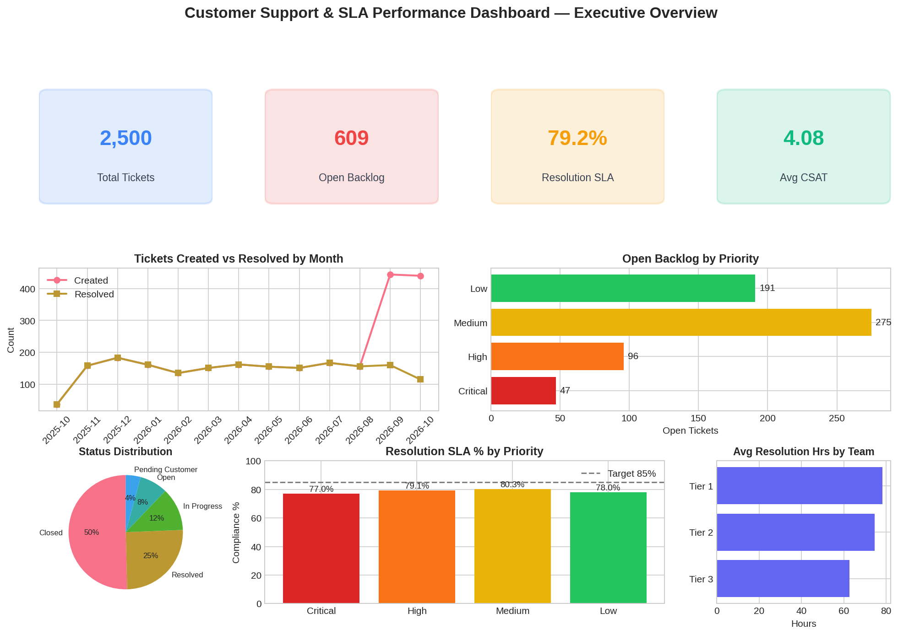
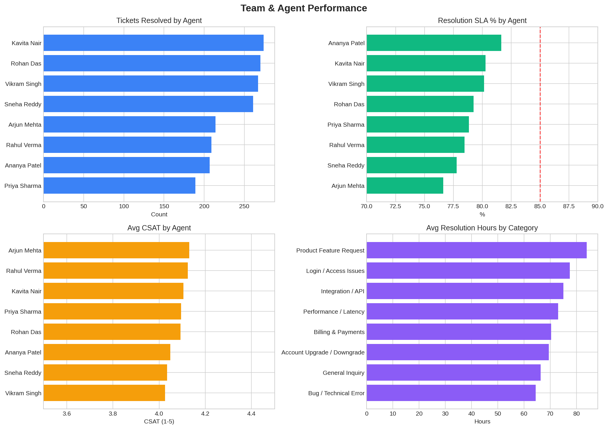
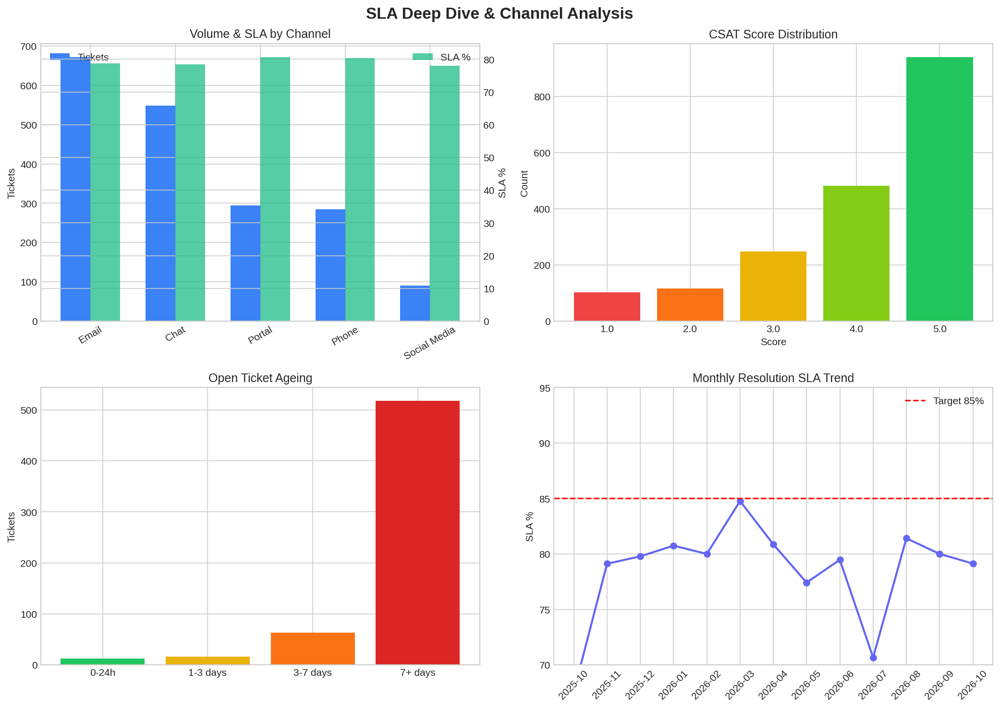

# Customer Support & SLA Performance Dashboard

[](./sql)
[](./docs/power_bi_guide.md)
[](./data/generate_sample_data.py)
[](#license)

> End-to-end analytics project for analyzing support tickets, resolution times, SLA compliance, backlog, and team performance.

A complete, portfolio-ready project demonstrating **SQL data modeling**, **KPI design**, **Power BI dashboard development**, and **business insight generation**.

---

## 📊 Dashboard Preview

| Executive Overview | Team Performance | SLA Deep Dive |
|:------------------:|:----------------:|:-------------:|
|  |  |  |

---

## ✨ Features

- **Star Schema** data model optimized for analytics
- **Realistic sample data** — 2,500 support tickets across 12 months
- **Ready-to-run KPI SQL queries** (volume, SLA, CSAT, backlog, ageing, trends)
- **Full Power BI implementation guide** with DAX measures
- **Data dictionary** and **business insights** report
- Regenerable sample data via Python script

---

## 📁 Project Structure

```text
Customer_Support_SLA_Dashboard/
├── data/
│   ├── fact_tickets.csv              # 2,500 tickets (fact table)
│   ├── dim_agents.csv                # Support agents
│   ├── dim_categories.csv            # Issue categories
│   ├── dim_priorities.csv            # Priorities + SLA targets
│   ├── dim_channels.csv              # Contact channels
│   └── generate_sample_data.py       # Regenerate sample data
├── sql/
│   ├── 01_schema.sql                 # Star schema + enriched view
│   ├── 02_kpi_queries.sql            # 10+ KPI queries
│   └── 03_load_data_example.sql      # Bulk load examples
├── docs/
│   ├── data_dictionary.md            # Complete data dictionary
│   ├── business_insights.md          # Findings & recommendations
│   └── power_bi_guide.md             # Power BI + DAX guide
├── images/                           # Dashboard screenshots
├── dashboard/                        # Place your .pbix file here
└── README.md
